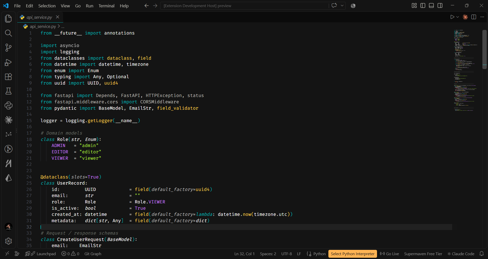
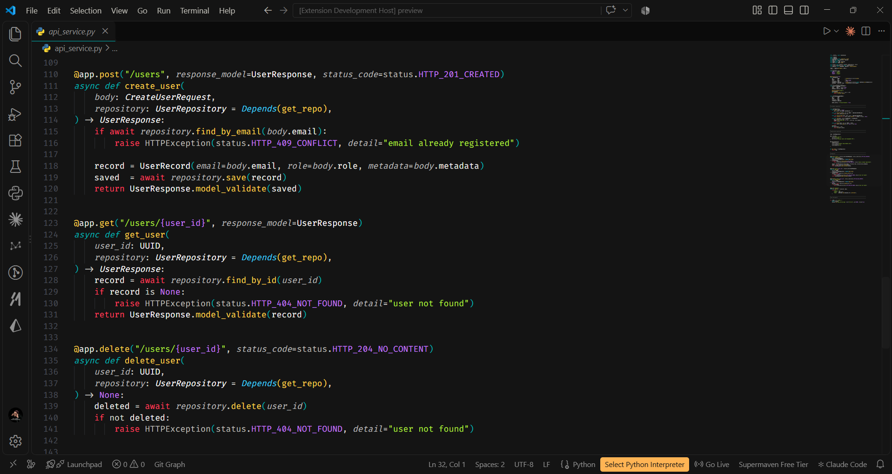
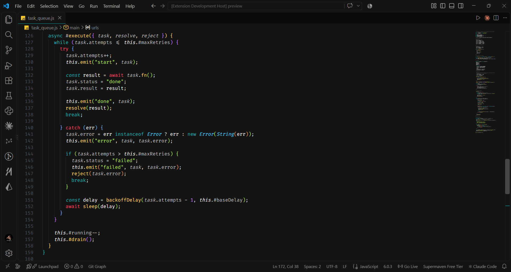
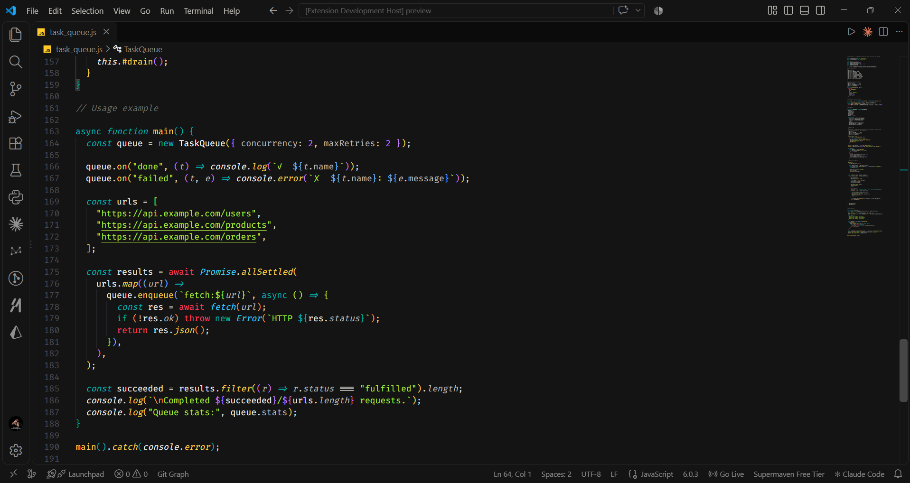

<div align="center">

# Immutable Theme

**The last VS Code theme you'll ever install.**

A calm, elegant dark theme built for developers who are done theme-hopping —
no neon bursts, no color overload. Just clean, focused code.

[](https://marketplace.visualstudio.com/items?itemName=tirth25.immutable-theme)
[](https://marketplace.visualstudio.com/items?itemName=tirth25.immutable-theme)
[](LICENSE)

</div>

---

## Preview

### Python — FastAPI service





### JavaScript — Async task queue





---

## Why Immutable?

Most themes get swapped out within a week. Immutable was designed so you never feel that itch.

- **Consistent elevation system** — backgrounds follow a strict 5-tier depth scale so the UI hierarchy is always clear, never accidental.
- **Semantic token coverage** — TypeScript, Python, Rust, Go, Java, and C# all get hand-tuned colors, not just TextMate fallbacks.
- **Every surface themed** — autocomplete widgets, inlay hints, diff views, merge conflicts, git decorations, notifications — nothing falls back to VS Code defaults.
- **Two depths, one identity** — pick the variant that suits your monitor and lighting. Both feel like the same theme.

---

## Variants

| Variant | Base background | Best for |
|---|---|---|
| **Immutable Theme (Lighter)** | `#1E1E1E` | Bright rooms, high-contrast monitors |
| **Immutable Theme (Darker)** | One step deeper | Low-light setups, OLED displays |

---

## Installation

**From the Marketplace (recommended)**

1. Open the Extensions view — `Ctrl+Shift+X`
2. Search **Immutable Theme**
3. Click **Install**
4. Open the Command Palette — `Ctrl+Shift+P` → **Preferences: Color Theme** → choose your variant

**From source**

```bash
git clone https://github.com/tirth-2510/immutable-theme
cd immutable-theme
```

Then press `F5` in VS Code to launch the Extension Development Host with the theme loaded.

---

## What's Themed

<details>
<summary>Click to expand the full surface list</summary>

- Editor, minimap, and scrollbars
- Activity bar, sidebar, and panel
- Tabs, breadcrumbs, and title bar
- Status bar (normal, debugging, no-folder)
- Terminal colors (all 16 ANSI slots)
- Autocomplete widget — including selected foreground and focus highlights
- Inlay hints (type hints, parameter names)
- Symbol icons (32 keys — autocomplete and symbol picker)
- Diff editor — gutter, overview ruler, and inline blocks
- Merge conflict blocks — current, incoming, and common ancestor
- Git decorations — added, modified, deleted, renamed, untracked, ignored, conflicting
- Peek view
- Search and search editor highlights
- Notification badges and icons (error, warning, info)
- Input validation (error, warning, info)
- Keybinding table
- Fold controls and comment range highlights
- Linked editing highlights (rename symbol)
- Semantic tokens — TypeScript, Python, Rust, Go, Java, C#

</details>

---

## Feedback

Spotted a color that clashes, a language that looks off, or have a suggestion?
[Open an issue on GitHub](https://github.com/tirth-2510/immutable-theme/issues) — all feedback is welcome.

---

<div align="center">
  Made with care · <a href="CHANGELOG.md">Changelog</a>
</div>
